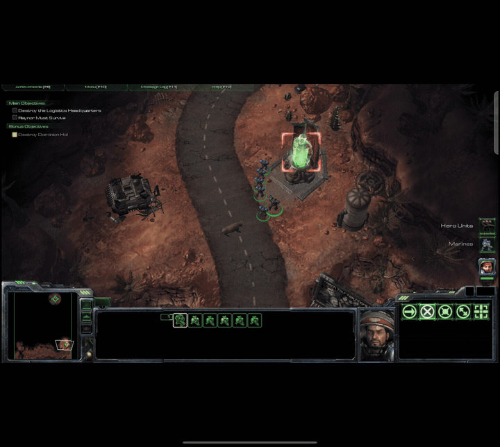
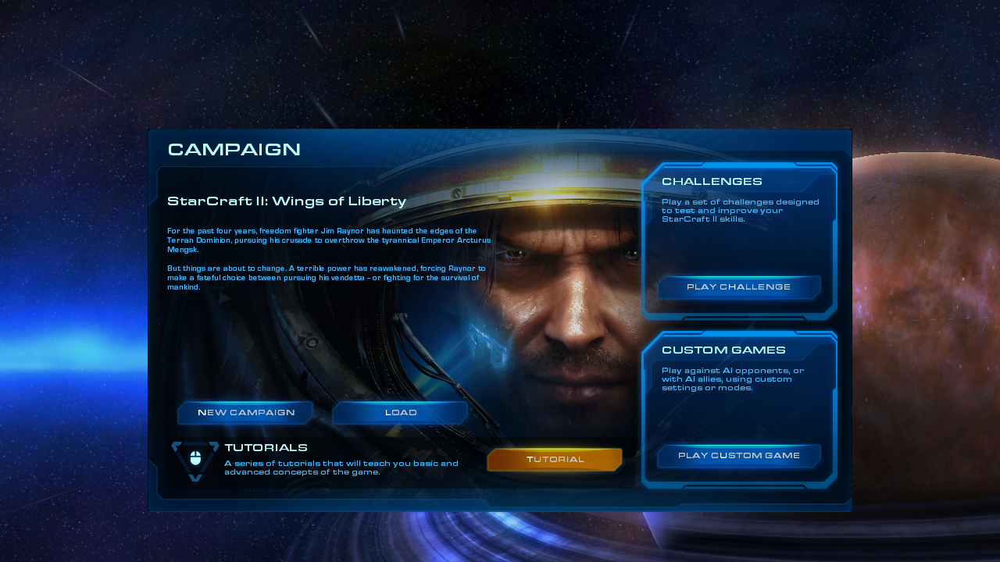
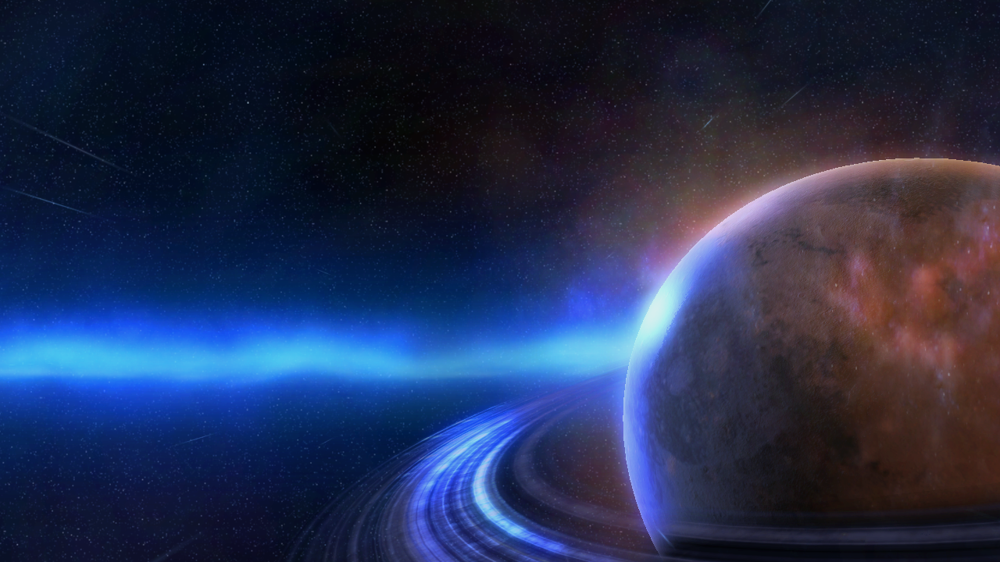
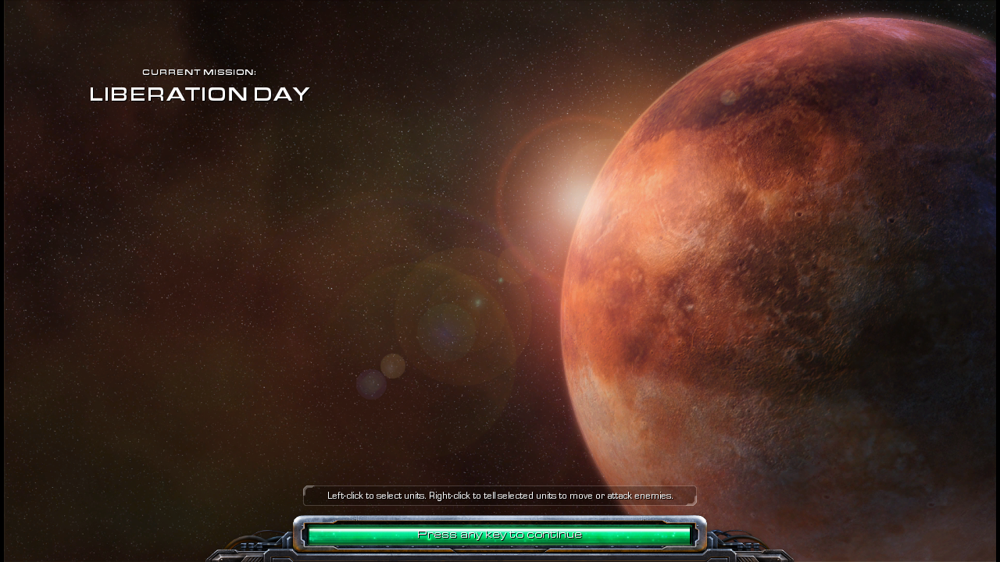
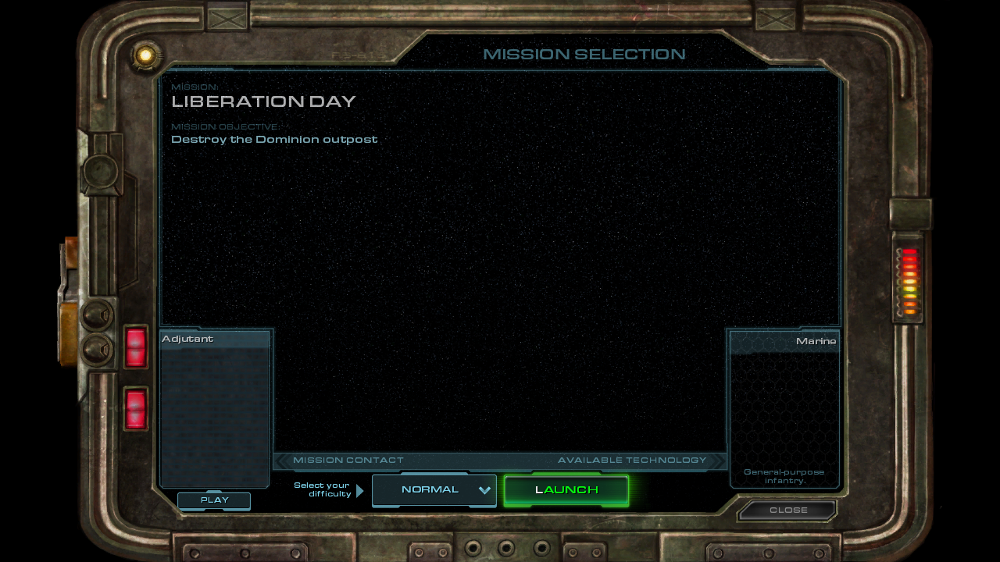
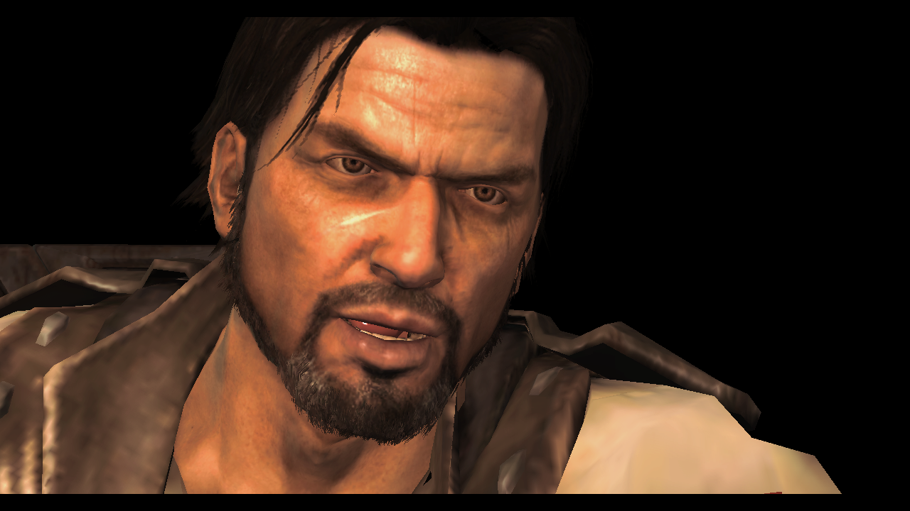
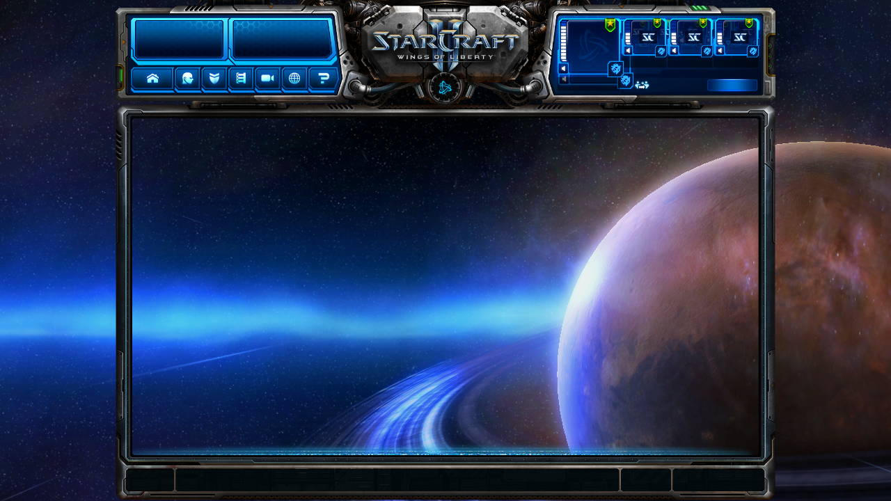

# StarCraft II on Android — Static Recompilation Toolkit

**[Version française 🇫🇷](README.fr.md)**

**From a 15.7 MB x86-32 Windows executable to a playable, signed Android APK with a
native Vulkan renderer — via AI-assisted static recompilation.** One week of work took
StarCraft II: Wings of Liberty (2010) from "it boots" to "the first campaign mission
plays end-to-end on a phone"; the second week made it a game you can actually use: a
title screen, saves, the whole campaign driven by an automated bench, offline skirmish
against the AI, 56–61 FPS on the device, and a native macOS host. This repository is the
complete method and toolchain, validated end-to-end, so you can do the same to **your**
D3D9-era game.

> **It contains no game code and no assets — never will.** Everything derived from the
> game is generated locally, from your own legitimate copy, by the tools published here.
> A CI scanner enforces this on every commit. Offline / single-player only.
> StarCraft® and Blizzard Entertainment® are trademarks of Blizzard Entertainment, Inc.
> Independent, non-commercial, unaffiliated project. Details: [LEGAL.md](LEGAL.md).

## Does it work? (October 24, 2026)

**The recompiled game, running on a Galaxy Z Fold 8, on the device itself** — box-selecting
units, hopping the camera through the minimap, then a gesture-home back to the Android
launcher:

| | | |
|---|---|---|
|  Campaign menu, Vulkan |  Menu & 3D scene |  Mission loading on device |
|  Mission-selection console |  In-engine cinematic |  Engine UI driven from the runtime |

*Captured from our own legitimate copy, for documentation purposes only.*

| At a glance | |
|---|---|
| Functions lifted to portable C | **86,653** (420 MB of C, builds on x86-64 Linux, Apple Silicon, aarch64 Android) |
| Certified against a hardware-reference emulator | **76,650** functions, **0 true divergence** |
| Campaign | **29 / 29 missions won** by the automated bench (reference run of Oct 23: no player, 0 crash, 0 missing function); **6 missions of act 1 in a row in a single launch** since guest memory is released between missions |
| Performance in active play | **56–61 FPS on a Galaxy Z Fold 8** — median at the 60 Hz vsync cap (28.1 on Oct 20, 4.1 at the first playable build) |
| Shaders | **all 75,797** shaders of the game's cache translated into a local SPIR-V pack — built on your machine from your copy, never distributed |
| Saves | save from the in-game menu, load back **at the saved state**, or start directly on a save (bench and Android emulator) |
| Skirmish | **offline, against the AI**, on the 63 melee maps found in the install's own cache — the Easy AI builds its base, attacks at 9 min and wins at 10 (bench); also runs on the Android emulator |
| Audio | mission soundtrack + voice reconstructed **bit-exact**; the ≈ 3,000 `.wav` sounds of rebuilt archives restored (hub: 40 → 219 sounds) |
| Hosts | Android (title-screen launcher: Continue, Load, Skirmish, Missions, Options) and **macOS** (windowed Cocoa app, Metal through MoltenVK, CoreAudio, keyboard/mouse/trackpad, launcher menus) |

## Project status

| Subsystem | State | Notes |
|---|---|---|
| Static recompilation (x86-32 → portable C) | ✅ done | CPU-struct reentrant model; generic lifter patches published (atomics, MMX, SSE lanes) |
| Vulkan renderer (D3D9 → Vulkan) | ✅ core complete | menus, 3D scenes, terrain, HUD, units, shadows (also on the Adreno 840), stencil, **instancing** (particles); explicit caps ([docs/CAPS.md](docs/CAPS.md)); MRT, clip plane and the Ultra portrait pending |
| Shader coverage | ✅ | full pack (75,797) generated locally; 0 draw falls back to the stand-in shader over the 29 missions |
| Audio (FMOD Ex → software mixer → AAudio / CoreAudio) | ✅ | bit-exact reconstruction; `.wav` aliases served by the runtime |
| Video (Theora) | ✅ | real time on device; optional H.264 hardware path |
| Input | ✅ | touch (1 finger = left click / box select, 2 fingers = right click), shortcut bar in the letterbox, BT keyboard/mouse; macOS: Cocoa events, AZERTY |
| Campaign | ✅ bench · 🟡 device | progression persists; 29/29 missions won at the bench; 6 in a row in one launch; an armory purchase works in the interface (ICU number formatting implemented: credits and costs display) |
| Saves | ✅ bench + emulator | save / load / start on a save; to be confirmed on the phone |
| Skirmish vs AI (offline) | ✅ bench + emulator | end-of-game detection for the bench; to be tried on the phone |
| Title screen (Android) | ✅ emulator | inner and outer screens of the foldable; on the phone next |
| macOS host | ✅ windowed | same binary as the bench (identical reference frames); hands-on session (sound, AZERTY, trackpad, fullscreen) pending |
| Performance | ✅ | 56–61 FPS on the Fold, capped by vsync; the remaining cost is the lifted code |
| Long sessions | 🟡 | the guest arena still grows ≈ 100 MB per mission after the memory-release pass: ≈ 10 missions per launch |

The full dated milestone log (35+ entries with the measurement behind each claim):
[docs/MILESTONES.md](docs/MILESTONES.md).

## Roadmap

| # | Milestone | Why it matters |
|---|---|---|
| 1 | **Phone session** with the latest build: title screen, save/load, skirmish, 20–30 min endurance | everything above is proven on the bench and the Android emulator; the device is the judge |
| 2 | **Render fidelity**: multiple render targets (a second target is bound on 23–39 % of draws), the one clip plane the game uses, the shadow pass with no color target, the grey portrait in Ultra | the last visible differences, found by state counters rather than by eye |
| 3 | **Whole campaign in one launch** — release the remaining per-mission growth | 6 missions in a row today, ≈ 10 per launch before the arena is exhausted |
| 4 | **Loading stalls** — build the archive index outside the global lock (0.85–2.4 s per large archive) | smoother loads and transitions |
| 5 | **macOS polish**: fullscreen, first launch from the Finder | a desktop build you can hand to a tester (privately: it contains recompiled code) |

## Port YOUR D3D9 game — the recipe

Everything above generalizes. The full step-by-step recipe — decision tree, inventory,
static analysis, lift, host runtime, the D3D9 device, shader translation, presentation,
the correctness oracle, the performance levers *in the order that paid*, effort
calibration and a pitfall checklist — is in
**[docs/D3D9-PORTING-GUIDE.md](docs/D3D9-PORTING-GUIDE.md)**. The short version:

1. Hash & extract your own copy; prune A/B to find the minimal dataset.
2. Ghidra headless: boot map + the import table as your API contract.
3. Lift with pcrecomp (CPU-struct model); apply the generic patches we published.
4. Host runtime: fibers, guest arena, traced IAT — **refuse, don't lie**.
5. D3D9 device in three tiers; prove the plumbing with a degenerate triangle first.
6. Translate the game's shader cache offline (decoder + translator here); validate
   every SPIR-V; hash bytecode by FNV everywhere.
7. Present headless → native bench → device; SUBOPTIMAL discipline; two frames in flight.
8. Difftest every function against a hardware-reference emulator; fingerprint frames; A/B/A.
9. Optimize in measured order: -O2 lift, O(1) dispatch, no TLS, fences, ring, locals.

## What's in this repository

| Path | What it is |
|---|---|
| `runtime/` | the **D3D9-on-Vulkan backend & host runtime** (original work): fake-COM device in the guest arena, guest-free Vulkan backend (instancing, stencil, deferred resource release), presentation, software FMOD Ex, Theora/AMediaCodec video, saves and documents, offline skirmish preparation, ICU number formatting, bench input module; `runtime/tests/` = its host tests |
| `tests-hote/` | the **fast gate**: an independent CMake project that builds and runs 33 host tests **without the lifted code** |
| `mac/` | the **macOS host**: Cocoa window and life cycle, Metal surface through MoltenVK, CoreAudio, keyboard/mouse mapping, event replay, launcher menus, configuration and install check |
| `android/` | the port: NativeActivity glue, bionic fibers, swapchain presenter, gestures and shortcut bar, title-screen launcher (Java), reproducible APK chain, validation benches |
| `scripts/` | benches and measurement: native bench, campaign and marathon runners, **event-driven scenarios** (`scripts/entrees/`), **non-regression** (`nonreg.sh`), A/B (`banc-ab.sh`, `fold-ab*`), phone sessions, graphics presets, lift transforms |
| `tools/difftest/` | the **per-function oracle**: lifted function vs Unicorn hardware reference, every register/flag/byte diffed |
| `tools/d3d9-shaders/` | **SM2/3 bytecode → SPIR-V**: decoder, translator, shader-cache extractor, frame metric |
| `tools/pcrecomp-*/` | generic lifter patches: atomics, MMX, `movhps`/`movhpd`, `movhlps`/`movlhps`, disasm32 memory |
| `tools/lift/` | incremental closure, dead-flag elimination, MMX inventory, relift guard |
| `tools/mpq/`, `tools/audio/` | size-checked MPQ extract/repack; MSVC-decorated import decoder; WAV proof checker |
| `interfaces/` | generated interface facts (PE layout, 755-slot IAT) + lift counters |

Scripts and tests keep the layout of the private working tree in some paths (`recomp-sc2/runtime` there is
`runtime/` here, `recomp-sc2/tests` is `runtime/tests/`); everything they read from the game comes from your install.

## Documentation

| Doc | Content |
|---|---|
| [docs/D3D9-PORTING-GUIDE.md](docs/D3D9-PORTING-GUIDE.md) | **the recipe to port your own D3D9 game** |
| [docs/RENDU-D3D9-VERS-VULKAN.md](docs/RENDU-D3D9-VERS-VULKAN.md) 🇫🇷 | the complete D3D9→Vulkan translation method (state model, descriptors, textures, shaders, shadows, presentation, transfers, 15 counter-intuitive decisions) |
| [docs/RETROSPECTIVE-RECOMPILATION.md](docs/RETROSPECTIVE-RECOMPILATION.md) 🇫🇷 | the 7-day engineering retrospective: milestones, 14 major difficulties, measurement discipline, measured dead ends |
| [docs/METHOD.md](docs/METHOD.md) | the end-to-end pipeline in one page |
| [docs/BANC-SCENARIOS.md](docs/BANC-SCENARIOS.md) 🇫🇷 | **event-driven bench scenarios and two-level non-regression** (smoke ≈ 14 min, full ≈ 2 h): format, triggers, criteria, how the judge itself is tested |
| [docs/MILESTONES.md](docs/MILESTONES.md) | the full dated milestone log |
| [docs/BRICKS.md](docs/BRICKS.md) | build bricks: Theora decoder cross-compile, local video transcode |
| [docs/PACK-SPIRV.md](docs/PACK-SPIRV.md) 🇫🇷 | the SPIR-V pack format |
| [docs/BANC-MAC.md](docs/BANC-MAC.md) 🇫🇷 | the native bench method (and the macOS app) |
| [docs/VARIABLES.md](docs/VARIABLES.md) 🇫🇷 | every `SC2_*` environment variable read by the code (checked by `scripts/variables-sc2.sh`) |
| [docs/CAPS.md](docs/CAPS.md) 🇫🇷 | the D3D9 caps the fake device announces, GPU profiles, and the state counters that decided the render work |

## Precedent watch

We track how projects comparable to this one fare. The closest analogue — a static
recompilation of a 2010 shooter ([bo1z](http://vel.gg/bo1z)) — was taken down with
**HTTP 451** in October 2026: it distributed game-derived code and binaries. This
project follows the opposite policy: method and original tooling only, **everything
derived from the game stays on the user's machine** ([LEGAL.md](LEGAL.md)). Watching
the ecosystem is part of the method — if its rules change, this policy changes with
them.

## License & legal

MIT for the tooling in this repository — original work, no Blizzard content. Built on
[pcrecomp](https://github.com/sp00nznet/pcrecomp) (MIT); see [LEGAL.md](LEGAL.md) for
the full policy (what is published, what never will be, third-party credits) and the
CI guard that enforces it.
